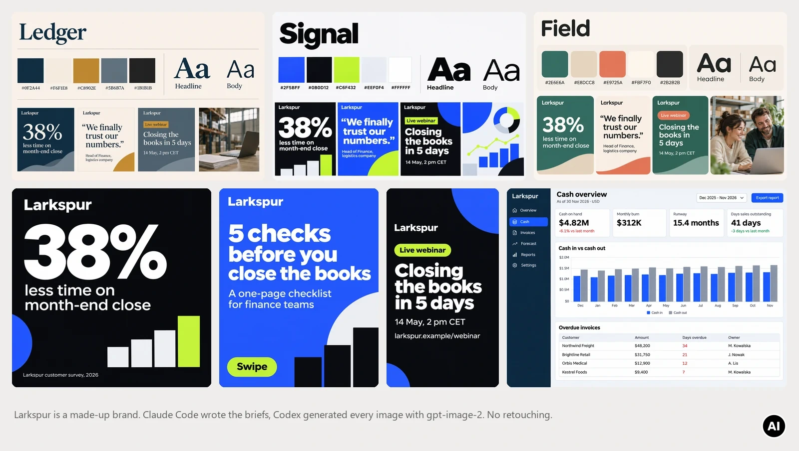
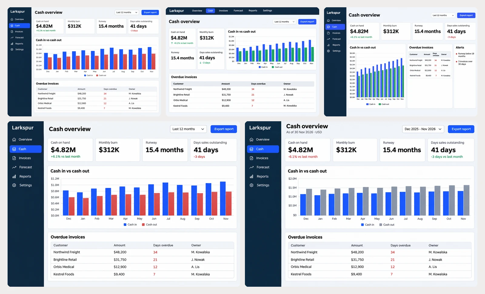

# Business examples

Three runs from 3 November 2026 for Larkspur, a made-up B2B finance analytics company: moodboards turned into social media templates, dashboard mockups fixed after a design review, and a second opinion on a pricing decision. They ran on a ChatGPT Plus plan with co-codex 0.5.0 and Codex CLI 0.166.0. Claude Code wrote every brief, and the files in [briefs/](briefs/) are the exact text it sent.

Everything on this page, the three Codex reviews included, moved the five-hour window from 4% to 9% and did not move the weekly window. All images were generated with AI (gpt-image-2 in Codex) and are shown without retouching.



In the commands below, `co-codex` stands for `node <skill dir>/scripts/co-codex.mjs`. In Claude Code you ask in plain words and the skill writes the commands.

## 1. From moodboards to social media templates

**Explore on `draft`.** Three moodboards for a LinkedIn template, one per visual direction, each with a palette, a type specimen, three sample posts and an image style ([brief](briefs/moodboards.md)):

```
co-codex spawn - --name biz-moodboard --tier draft --images --names ledger.png,signal.png,field.png --sandbox read-only --wait --out moodboards --json < moodboards.md
```

One turn on GPT-6 Luna, 2 minutes 11 seconds, three images at 1536x1024. Every hex code and every word on the boards matched the brief.

**Let Codex judge.** `opinion` with the image files: Codex opens them and ranks the directions against the audience and the production constraints ([brief](briefs/judge-moodboards.md)). Claude wrote its own ranking first, so Codex's view could be compared without anchoring.

```
co-codex opinion - --on "choice between three social media design directions" --file moodboards/ledger.png --file moodboards/signal.png --file moodboards/field.png --json < judge-moodboards.md
```

Codex ranked Signal, Ledger, Field, the same order as Claude. It sampled pixels and computed contrast ratios, and found two problems:

- Signal's lime chart marks on light grey: #C6F432 on #EEF0F4 is 1.12:1, so lime may carry shapes on dark backgrounds only.
- Field's white "Live webinar" badge on coral is 2.99:1. Claude missed this one.

All six ratios Codex quoted are correct. It also disagreed with one of Claude's reasons: Claude had ranked Ledger and Field lower for needing photography, and Codex pointed out that their text tiles already work without photos.

**Finalize on `high`.** The chosen board goes back as a style reference, with the contrast rule written into the brief ([brief](briefs/social-templates.md)):

```
co-codex spawn - --name biz-social-final --tier high --images --ref moodboards/signal.png --names post-stat-1x1.png,carousel-cover-4x5.png,story-webinar-9x16.png --sandbox read-only --wait --out templates --json < social-templates.md
```

5 minutes 26 seconds on GPT-6.1 Sol: a 1:1 post (1254x1254), a 4:5 carousel cover (1122x1402) and a 9:16 story (941x1672). Every word is as given, and the story keeps its top 14% and bottom 20% free. It took 6 generations for 3 images. Codex redid each one to get closer to the exact hex values, and the drift it chased was a few units (#080A0F instead of #0B0D12). When the colours will be set in the real template anyway, `--retries 0` saves those generations.

## 2. Dashboard mockups and a design review



**Three layouts on `draft`** ([brief](briefs/dashboard-mockups.md)): left sidebar and roomy, top navigation and compact, and an analyst layout with an alerts panel. 2 minutes 57 seconds, every label and number spelled as given.

**Design review by Codex** ([brief](briefs/review-dashboard.md)), again with the PNGs passed through `--file`. The brief asked Codex to check whether each screen tells the truth. It picked variant 1, as Claude did, and listed what must change first:

- Every chart shows more cash coming in than going out, while the cards say "Monthly burn $312K".
- "+6.1% vs last month" on $4.82M means about +$277K, which also contradicts the burn. Claude missed this.
- "-3 days" of DSO is red in variants 1 and 3, but faster collection is good news.
- Cash out is drawn in the same green as good news in variants 2 and 3.
- No as-of date, currency or comparison period, so a CFO cannot tell what an export shows. Claude missed this too.
- The brief contradicts itself: the alert says "3 invoices over 30 days", the table has one. That mistake was Claude's, in the brief.

**The fix goes to the same session** with the old file as the edit target ([brief](briefs/dashboard-fix.md)), this time with the monthly chart values spelled out:

```
co-codex send biz-dashboard - --tier high --images --ref mockups/cash-1.png --names cash-1.png --replace --sandbox read-only --wait --out mockups --json < dashboard-fix.md
```

2 minutes 16 seconds, one image. The layout stayed in place, all four changes are in, and the draft moved to `mockups/_rejected/cash-1-replaced.png`. The session ran this turn on GPT-6.1 Sol and switched back to GPT-6 Luna afterwards.

Lesson: give a mockup its chart data, or at least say which series is larger. Left alone, it invents plausible numbers that contradict its own KPI cards.

## 3. Second opinion on a pricing decision

The plan moves all 140 customers from per-seat to usage-based pricing (0.90 EUR per report), announced on 1 December for renewals from the same day ([full plan](briefs/pricing-plan.md)). It has five flaws planted on purpose: no notice period despite a 60-day clause, uncapped bills announced after the buyers' budgets are set, an 18% uplift extrapolated from the 20 largest customers, sales commission still paid on seats that no longer cost anything, and customer success briefed only after the announcement.

```
co-codex opinion - --on "pricing change decision for a B2B SaaS" < pricing-plan.md
```

Trimmed output:

```
Verdict: rethink (confidence high)
Do not approve the universal migration as proposed. The notice timing conflicts with the stated
contract constraint, the 18% forecast is unsupported, and the plan introduces budget uncertainty
and misaligned sales incentives.

Concerns:
  [high] The announcement and effective dates do not allow the stated notice period.
  [high] The expected 18% uplift across the base is not supported by the sample or model.
      evidence: ... At EUR 0.90 per report, a customer currently paying EUR 18,000 breaks even
      at 20,000 reports annually; the supplied material gives no base-wide volume distribution.
  [medium] The forecast conflates annualized revenue potential with revenue earned during 2027.
  [high] Uncapped charges arrive after the buyers' budgeting window.
  [medium] Seat-based commission loses its connection to revenue.
  [medium] The billable report and billing readiness are unspecified.
  [medium] Customer success preparation happens too late.
```

Codex found all five planted flaws. Claude's own review, written before it read Codex's, found them too and reached the same verdict. Codex added three points Claude did not have: the break-even volume, the gap between annualized revenue and revenue earned in 2027 when contracts renew month by month, and the undefined billable event (retries, failed generations, duplicates).
